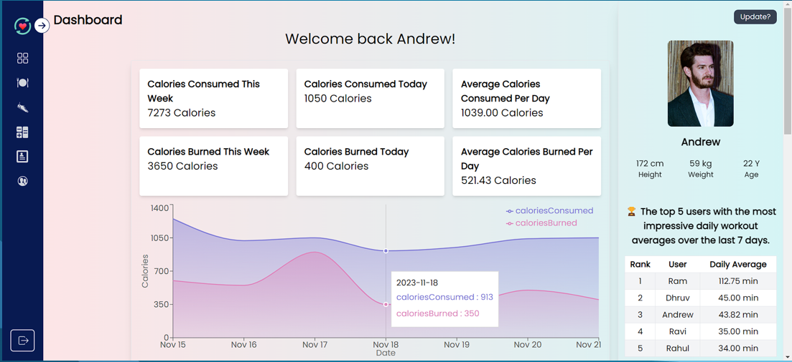
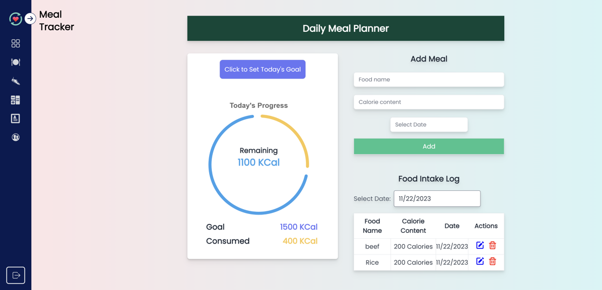
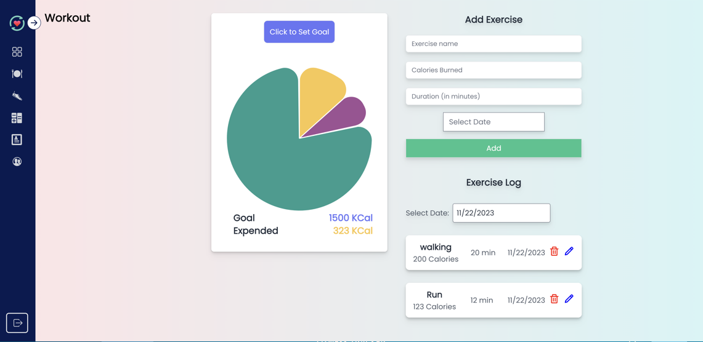
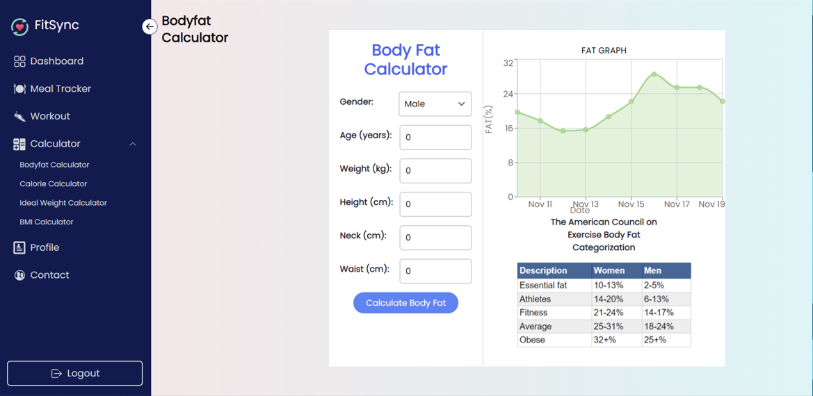
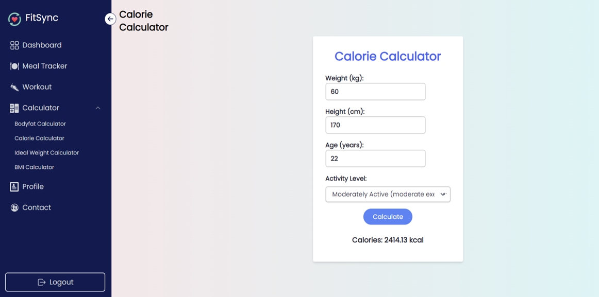

# FitSync

FitSync is a full-stack fitness tracker for recording workouts, monitoring
nutrition and body progress, and viewing personalized dashboard insights. It is
built as a React and Express modular monolith backed by MongoDB.



## Highlights

- JWT authentication with bcrypt password hashing and role-based authorization.
- Owner-scoped workout, nutrition, progress, profile, and avatar operations.
- Versioned REST API with validation, pagination, rate limiting, secure headers,
  and centralized error handling.
- Server-calculated BMI and daily progress upserts for consistent health data.
- Short-lived, single-use password-reset tokens. SMTP is optional locally.
- Responsive React dashboard, charts, calculators, and paginated activity views.
- Backend unit and MongoDB integration tests.
- One-command local stack using Docker Compose.

## Technology

| Layer | Technology |
| --- | --- |
| Frontend | React 18, Vite, React Router, Tailwind CSS, Chart.js, Recharts |
| Backend | Node.js 24, Express, Mongoose, JWT, bcrypt |
| Database | MongoDB 8 |
| Testing | Node test runner, Vitest |
| Local deployment | Docker, Docker Compose, Nginx |

## Architecture

```text
Browser (React/Vite)
        |
        | HTTP + Bearer JWT
        v
Express /api/v1
  |-- authentication and authorization
  |-- validation and centralized errors
  |-- users, workouts, nutrition, progress, dashboard, media
        |
        v
MongoDB
```

The API derives record ownership from the authenticated user rather than trusting
client-supplied user IDs. Collection endpoints are paginated and owner-filtered;
the leaderboard exposes only the limited aggregate fields documented in the API.

## Quick start with Docker

Prerequisites: Docker Desktop or another Docker Compose-compatible runtime.

```powershell
docker compose up --build -d
docker compose ps
```

Open `http://localhost:3000`. The API is available at
`http://localhost:4000/api/v1`, while MongoDB remains on the private Compose
network.

MongoDB records and avatars are stored in named volumes. Stop the stack without
deleting them:

```powershell
docker compose down
```

To intentionally delete the local volumes as well:

```powershell
docker compose down -v
```

The Compose configuration uses a development-only JWT fallback. For a less
predictable local value, create an ignored root `.env` file:

```env
JWT_SECRET=replace-with-a-long-random-local-secret
```

## Run without Docker

Prerequisites: Node.js 24, npm, and MongoDB on `127.0.0.1:27017`.

Backend:

```powershell
Copy-Item backend/.env.example backend/.env
Set-Location backend
npm ci
npm run dev
```

Frontend, in another terminal:

```powershell
Copy-Item frontend/fit-sync/.env.example frontend/fit-sync/.env
Set-Location frontend/fit-sync
npm ci
npm run dev
```

Open `http://localhost:5173`.

## Tests

Database-independent backend tests:

```powershell
Set-Location backend
npm ci
npm test
```

MongoDB integration tests use a disposable database and remove it when finished:

```powershell
$env:MONGODB_TEST_URI="mongodb://127.0.0.1:27017/fitsync_integration_test"
npm run test:integration
```

Frontend tests and production build:

```powershell
Set-Location frontend/fit-sync
npm ci
npm test
npm run build
```

## Configuration and security

Copy the committed examples when configuring the application:

- [`backend/.env.example`](backend/.env.example)
- [`frontend/fit-sync/.env.example`](frontend/fit-sync/.env.example)

Real `.env` files, uploaded avatars, dependencies, logs, and build output are
ignored by Git. Never commit production JWT, database, email, or hosting
credentials. See [`SECURITY.md`](SECURITY.md) for the reporting policy and
security notes.

Password-reset email and the contact form require SMTP configuration. When SMTP
is omitted in development, password reset returns a local one-time reset URL for
testing. Local avatar storage is suitable for Docker development; use persistent
object storage before deploying the backend to an ephemeral host.

## API documentation

The REST API is documented in [`docs/API.md`](docs/API.md). Main resource groups:

- `/api/v1/auth`
- `/api/v1/users`
- `/api/v1/workouts`
- `/api/v1/nutrition-entries`
- `/api/v1/progress-entries`
- `/api/v1/dashboard`
- `/api/v1/media`

The original audit and implementation status are recorded in
[`docs/REVAMP_PLAN.md`](docs/REVAMP_PLAN.md).


## Screenshots

<p align="center">
  
  
</p>
<p align="center">
  
  
</p>

## License

Released under the [MIT License](LICENSE).
